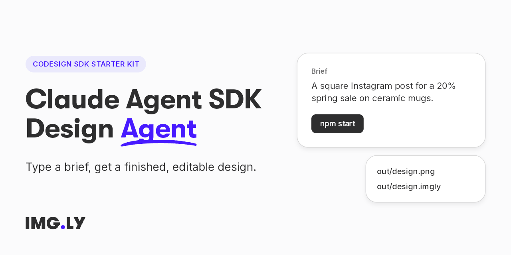

<p align="center">
  
</p>

# Claude Agent SDK Design Agent — a CoDesign SDK Quickstart

A Node.js starter kit that runs a design agent on the Claude Agent SDK: type a
brief, and the agent designs it with IMG.LY's CoDesign SDK and hands you a PNG
and an editable design. It is for engineers who want to add AI design
generation to their product with the Claude Agent SDK.

**Documentation:**
[Quickstart: Claude Agent SDK](https://img.ly/docs/cesdk/codesign/starter-kits/quickstart-claude-agent-sdk-cdsqca/) ·
**The same quickstart on:** [Vercel AI SDK](https://github.com/imgly/starterkit-codesign-quickstart-ai-sdk-js-node) · [OpenAI Agents SDK](https://github.com/imgly/starterkit-codesign-quickstart-openai-agents-js-node) · [LangChain.js](https://github.com/imgly/starterkit-codesign-quickstart-langchain-js-node) · [Mastra](https://github.com/imgly/starterkit-codesign-quickstart-mastra-js-node) · [pi](https://github.com/imgly/starterkit-codesign-quickstart-pi-js-node)

**It needs your own Anthropic API key** (`ANTHROPIC_API_KEY` in `.env`) for
the model: IMG.LY's AI gateway does not serve the Claude Agent SDK's API
(Anthropic's Messages API).

Terms used below: **CE.SDK** is IMG.LY's design engine and editor. A
**design** is a CE.SDK scene, saved as an `.imgly` file. The **CoDesign SDK**
(`@imgly/codesign-sdk`) gives an AI model the tools to read, change, preview,
and export designs. The **executor** is where those tools run a CE.SDK engine:
here IMG.LY's `imgly/codesign-executor` Docker image on your machine. The
**Claude Agent SDK** (`@anthropic-ai/claude-agent-sdk`) is Anthropic's agent
loop, the one Claude Code runs on.

## What You Get

- One script, `design.mjs`, that hands CoDesign's design tools to
  the Claude Agent SDK and runs the agent on your brief.
- Two files per run: `out/design.png`, and `out/design.imgly`, the editable
  design with its images and fonts.
- The design engine as IMG.LY's `imgly/codesign-executor` Docker image,
  started with `npm run executor`.
- The model, Claude, through your Anthropic API key.

## What's Inside

```
design.mjs      # the agent runner: serves the tools to the Claude Agent SDK, runs Claude, exports the result
.env.template   # the variables both read; copy it to .env
package.json    # the SDK, the Claude Agent SDK, and the MCP SDK, at exact versions; `npm run executor` starts the executor
tsconfig.json   # `npm run check` type-checks design.mjs
```

## Run It

You need Docker, Node.js 22 or newer, a **CoDesign license key**, which starts the
design engine and pays for each exported file, and an **Anthropic API key**
([console.anthropic.com](https://console.anthropic.com/settings/keys)), which
pays for the model. [Contact sales](https://img.ly/forms/contact-sales/) to get a CoDesign license key.

```sh
npm install
cp .env.template .env
```

`npm install` also downloads the Claude Code program for your platform (about
250 MB), which the Claude Agent SDK runs.

In `.env`, set `IMGLY_CESDK_LICENSE` to your CoDesign key and
`ANTHROPIC_API_KEY` to your Anthropic key; `EXECUTOR_TOKEN` is already filled
in. Then start the executor and check
that it answers:

```sh
npm run executor
curl http://localhost:8080/health
# {"result":{"sessions":0,"accepting":true,"bound":false,...}}
```

The first start downloads the image. If `/health` does not answer, run
`docker logs codesign-executor`: the executor stops at start when the key is
missing or cannot be activated, or when it cannot reach `api.img.ly`.

Then design something:

```sh
npm start -- "A square Instagram post for a 20% spring sale on ceramic mugs. Calm, premium, lots of white space."
```

You see each tool call as it happens (`✓ …`), then the model's one-sentence
summary, a line with the steps, seconds, and tokens, and last
`Wrote out/design.png and out/design.imgly`. A run takes around 3 minutes, depending on the model and how hard the brief is.

- `out/design.png` is a picture of the design.
- `out/design.imgly` is the editable design, with its images and fonts. Open
  it in a CE.SDK editor of exactly the version the executor runs, which the
  SDK exports as `CESDK_VERSION`: an older or newer editor that saves it drops
  what the other version wrote.

To stop and remove the executor, run `npm run executor:stop`.

### Only the Design Tools

The Claude Agent SDK runs Claude Code, which has its own tools for the shell,
files, and the web. `design.mjs` turns all of them off (`tools: []`), loads no
settings, hooks, plugins, or MCP servers from your machine
(`settingSources: []`, `strictMcpConfig`), and refuses any tool it did not
allow (`permissionMode: 'dontAsk'`). The agent can only design, and the
model's code runs in the executor, not on your machine.

### The Executor Between Runs

The executor serves one conversation, the id `design.mjs` sets
(`quickstart`), and exits half a minute after the script releases the design
at the end of a run. Docker starts it again (`--restart always`), and it keeps
its conversation in memory (`--tmpfs`), so it comes back ready for your next
run. A run that starts in the few seconds of a restart fails with
`executor_unreachable`: wait until `/health` answers again.

Before you run the executor anywhere but your machine, follow
[Host the Executor](https://img.ly/docs/cesdk/codesign/deploy/host-the-executor-cdshst/).

## What It Costs

Each run exports one PNG, which is charged to the IMG.LY account behind the
CoDesign key; the `.imgly` file, the edits, and the previews are free. The
model's tokens are charged to your Anthropic account.

## Make It Yours

- Keep the design in your database: pass `designs`, a `read` and a `write`
  over the table your editor saves to.
- Start from a customer's file (PSD, PDF, `.imgly`): call
  `codesign.load(bytes)` before the model runs.
- Give the model your brand and media: add your own CE.SDK plugin to
  `plugins`.
- Give each conversation its own executor: make `acquire` answer a new
  container per conversation.

## Variables

| Variable              | What it is                                                                  |
| --------------------- | --------------------------------------------------------------------------- |
| `IMGLY_CESDK_LICENSE` | Your CoDesign license key. The executor uses it for the engine and exports. |
| `EXECUTOR_TOKEN`      | A secret the executor and the script share. A different one gets 401.       |
| `ANTHROPIC_API_KEY`   | Your Anthropic API key, for the model.                                      |
| `MODEL`               | Optional. Default `claude-opus-5`; for example `claude-sonnet-5`.           |
| `EXECUTOR_URL`        | Optional. Default `http://localhost:8080`.                                  |

## Troubleshooting

| Symptom                                                     | Cause and fix                                                                                                                                                    |
| ----------------------------------------------------------- | ---------------------------------------------------------------------------------------------------------------------------------------------------------------- |
| `The container name "/codesign-executor" is already in use` | The executor is already running. Check `curl http://localhost:8080/health`, or run `npm run executor:stop` first.                                                |
| `node: .env: not found`                                     | Copy `.env.template` to `.env`.                                                                                                                                  |
| `Missing IMGLY_CESDK_LICENSE, EXECUTOR_TOKEN`               | Set both in `.env`.                                                                                                                                              |
| `Set ANTHROPIC_API_KEY in .env`                             | Anthropic refused the key, or none is set: set `ANTHROPIC_API_KEY` in `.env`.                                                                                    |
| `missing or wrong executor token`                           | The executor answered 401 with another token: after changing `EXECUTOR_TOKEN`, run `npm run executor:stop` and `npm run executor` again so the executor gets it. |
| `executor_unreachable`                                      | The executor is not running or restarting: check `curl http://localhost:8080/health`.                                                                            |
| `The model stopped early`                                   | The model reached the 60-turn limit or stopped for another reason; no PNG was exported, and the design so far is in `out/design.imgly`.                          |

## FAQ

### Which models can it use?

Claude models: set `MODEL` in `.env`, for example `claude-sonnet-5`. The
default is `claude-opus-5`.

### Do I need an account with a model provider?

Yes, an Anthropic API key: IMG.LY's AI gateway does not serve Anthropic's
Messages API, which the Claude Agent SDK calls.

### Can a person keep editing the design?

Yes. `out/design.imgly` opens in a CE.SDK editor of exactly the version the
executor runs, which the SDK exports as `CESDK_VERSION`.

## License

This kit is licensed under IMG.LY's license; see `LICENSE.md`. Using the CoDesign
SDK and the executor needs a CoDesign license key. [Contact sales](https://img.ly/forms/contact-sales/) to get a CoDesign license key. The Claude Agent
SDK is Anthropic's, under Anthropic's terms.

---

<p align="center">Built with CoDesign by <a href="https://img.ly">IMG.LY</a></p>
